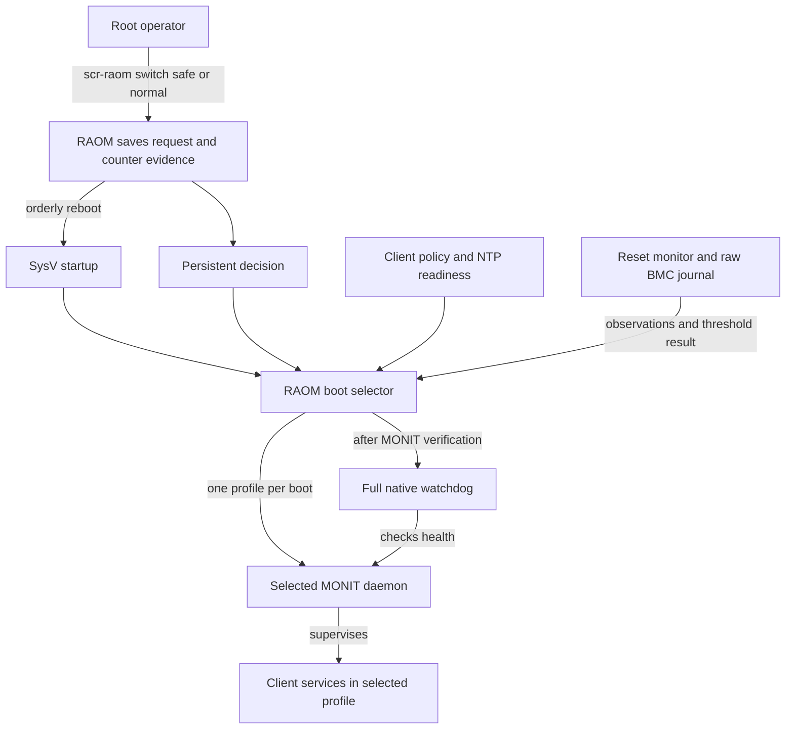
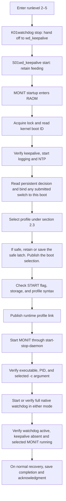
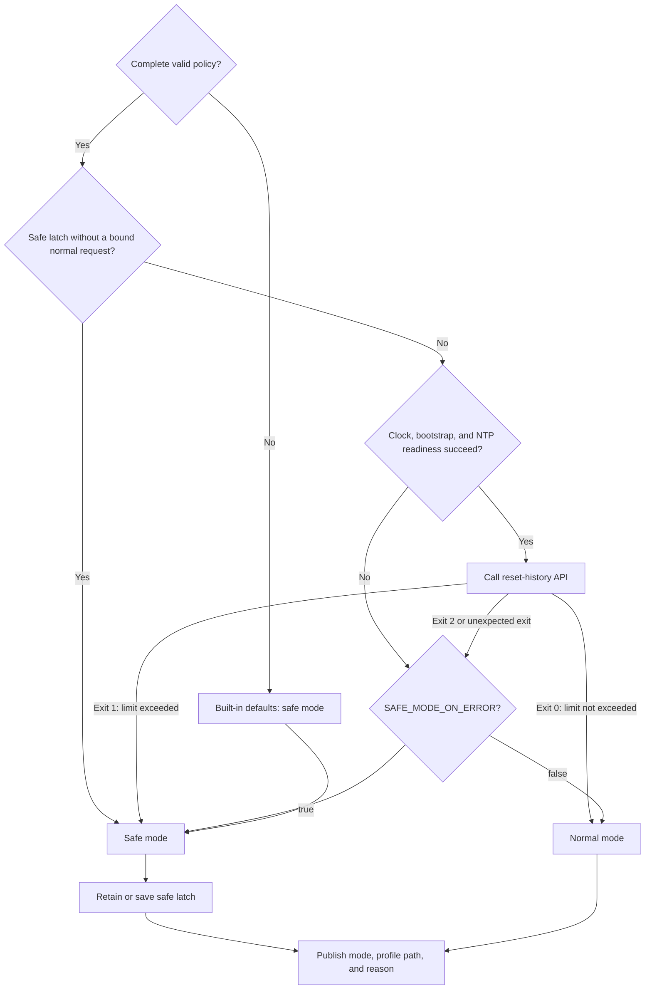

# 1. Overview

RAOM selects one MONIT profile per boot. A root operator can request an orderly reboot into the opposite mode.
From normal mode, `scr-raom switch safe` requests safe mode regardless of the reset count.
After manual entry, a reset threshold violation, or an error that selects safe, the device stays in safe mode across reboots.
To leave safe mode, an operator must run `scr-raom switch normal` and the device must complete normal recovery.

| # | Mode | Purpose | Default profile |
| --- | --- | --- | --- |
| 1 | Normal | Run client production services. Platform supplies profile contents. | `/etc/monit/monitrc` |
| 2 | Safe | Run client recovery services. The shipped sample monitors the native watchdog. | `/etc/monit/raom/safe.monitrc` |

MONIT supervises the services in the selected profile. The client supplies their definitions.
In both modes, RAOM activates the full native watchdog after it verifies the selected MONIT daemon.
Native `wd_keepalive` feeds the hardware timer during boot decisions and planned MONIT stops.

Debian package `scr-raom` 1.1.1 delivers RAOM and the [reset-history API](../resets-monitor/README.md).

<div style="page-break-after: always;"></div>

# 2. High Level & Low Level Design

## 2.1 High-level architecture

RAOM owns the reboot request, persistent safe mode, and the selection for each boot.
The reset monitor owns the BMC observations, journal, and reset-window calculation.



## 2.2 Boot process

Runlevels 2–5 retain scheduler identity `monit`. Legacy `S03monit` links target `scr-raom`.
Dependency-based startup uses adapted `/etc/init.d/monit`. Both routes reach RAOM before MONIT starts.

Diagram shows first service start in a new boot. Startup errors can stop launch at each validation or handoff boundary.



RAOM holds one lock through bootstrap, selection, publication, and service action.
Later service starts reuse current-boot selection. They validate selected profile without repeating reset evaluation.
Configuration edits affect selection on next boot. Profile contents remain client-managed and can change at selected path.

Native logging and NTP startup each use separate 10-second command budgets.
When evaluation needs NTP, the readiness wait adds up to `NTP_SYNC_TIMEOUT_SECONDS` (default 60 seconds) after bootstrap and switch observation.
Native networking, logging, and NTP can run during this delay. MONIT-managed applications and full watchdog checks wait. Keepalive feeds the timer.
Linux `/proc/uptime` supplies the deadline. A timeout means RAOM could not confirm synchronization.

### 2.2.1 High-level algorithm

This algorithm describes service startup and later service actions. Standalone `select` requires caller-managed bootstrap, as described in section 3.4.
Section 3.4.1 describes the operator request that precedes a switch reboot.

1. ENTER RAOM through SysV startup.
   1. **1.1** ACQUIRE exclusive lock for selection and service changes.
   2. **1.2** READ current kernel boot identity.
   3. **1.3** ***if*** valid selection exists for this boot ***then***
      1. **1.3.1** REUSE saved mode and MONIT profile.
      2. **1.3.2** CONTINUE at step 6.
   4. **1.4** ***else if*** selection is corrupt ***then***
      1. **1.4.1** STOP startup with an error.

2. PREPARE boot services.
   1. **2.1** TRANSFER hardware timer feeding from full watchdog to `wd_keepalive`.
   2. **2.2** ***if*** transfer cannot be verified ***then***
      1. **2.2.1** STOP startup with an error.
   3. **2.3** START native logging service.
   4. **2.4** START native NTP service.
   5. **2.5** RECORD bootstrap failures for mode selection.
   6. **2.6** READ the private persistent decision.
      1. **2.6.1** ***if*** the decision is missing, corrupt, ***or*** unsafe ***then***
         1. **2.6.1.1** STOP startup.
   7. **2.7** ***if*** a submitted switch reaches a new boot ***then***
      1. **2.7.1** BIND the request once to this destination boot with safe as fallback.
      2. **2.7.2** CAPTURE the first destination observation before the NTP readiness wait.
      3. **2.7.3** ***if*** capture succeeds ***and*** native accounting identifies this switch reboot ***then***
         1. **2.7.3.1** SAVE that observation as the endpoint.
      4. **2.7.4** ***else***
         1. **2.7.4.1** KEEP the endpoint unavailable.
   8. **2.8** READ the safe latch and any bound normal request.

3. LOAD client policy from `/etc/default/scr-raom`.
   1. **3.1** ***if*** complete policy is valid ***then***
      1. **3.1.1** USE configured reset limit, reset window, NTP timeout, error policy, and profile paths.
      2. **3.1.2** ***if*** the latch is safe ***and*** no bound normal request exists ***then***
         1. **3.1.2.1** SELECT safe with reason `switch_safe` on manual entry or `persistent_safe` on later boots.
         2. **3.1.2.2** CONTINUE at step 5 without the NTP readiness wait or reset check.
   2. **3.2** ***else***
      1. **3.2.1** USE complete built-in defaults.
      2. **3.2.2** SELECT safe mode with reason `configuration_invalid`.
      3. **3.2.3** CONTINUE at step 5.

4. DETERMINE operating mode for ordinary evaluation or a bound normal request.
   1. **4.1** ***if*** bootstrap and monotonic clock are usable ***then***
      1. **4.1.1** WAIT for NTP synchronization within `NTP_SYNC_TIMEOUT_SECONDS`.
      2. **4.1.2** ***if*** synchronization succeeds ***then***
         1. **4.1.2.1** CALL the reset check in section 2.3 with any saved acknowledgment and switch interval.
         2. **4.1.2.2** ***case*** returned result ***of***
            1. **4.1.2.2.1** `0`: SELECT normal mode.
            2. **4.1.2.2.2** `1`: SELECT safe mode because resets exceed configured limit.
            3. **4.1.2.2.3** ***default***: RECORD reset evidence or command failure.
      3. **4.1.3** ***else***
         1. **4.1.3.1** RECORD NTP timeout or clock failure.
   2. **4.2** ***else***
      1. **4.2.1** RECORD bootstrap or clock failure.
   3. **4.3** ***if*** an error prevents a threshold decision ***then***
      1. **4.3.1** ***if*** `SAFE_MODE_ON_ERROR` is `true` ***then***
         1. **4.3.1.1** SELECT safe mode.
      2. **4.3.2** ***else***
         1. **4.3.2.1** SELECT normal mode.

5. COMMIT boot decision.
   1. **5.1** SELECT profile associated with chosen mode.
      1. **5.1.1** ***if*** this decision enters safe mode ***then***
         1. **5.1.1.1** SAVE the safe latch before publishing the boot selection.
   2. **5.2** SAVE boot identity, mode, profile, and reason atomically.
   3. **5.3** LOG `decision_ms`, measured from bootstrap entry through decision publication.

6. START selected MONIT instance.
   1. **6.1** VALIDATE native MONIT options, selected profile, and required storage.
   2. **6.2** PUBLISH selected profile pointer.
   3. **6.3** START MONIT with explicit selected configuration, unless matching instance already runs.
   4. **6.4** VERIFY one MONIT daemon matches its binary, PID, explicit `-c` argument, and selected profile link.
   5. **6.5** DELEGATE service supervision to MONIT.

7. ACTIVATE the full native watchdog in both modes.
   1. **7.1** ***if*** committed selection and running MONIT configuration match ***then***
      1. **7.1.1** START native watchdog, unless it already runs.
      2. **7.1.2** VERIFY full watchdog active, keepalive absent, and selected MONIT still running.
   2. **7.2** ***else***
      1. **7.2.1** ATTEMPT verified hardware feeding through `wd_keepalive`.
      2. **7.2.2** REJECT watchdog activation.
   3. **7.3** ***if*** watchdog launch fails ***then***
      1. **7.3.1** ATTEMPT verified transfer to `wd_keepalive`.
      2. **7.3.2** REPORT startup failure.
   4. **7.4** ***if*** normal recovery passes these checks for the current decision and destination ***then***
      1. **7.4.1** SAVE normal mode, the recovery acknowledgment, and the fixed switch interval together.
      2. **7.4.2** ***if*** the completion save fails ***then***
         1. **7.4.2.1** REPORT recovery failure. Safe remains the fallback for the next boot.

8. HANDLE subsequent service actions.
   1. **8.1** REUSE committed mode throughout current boot.
   2. **8.2** ***if*** MONIT stop or restart is requested ***then***
      1. **8.2.1** VERIFY transfer to `wd_keepalive` before stopping MONIT.
   3. **8.3** ***if*** restart is requested ***then***
      1. **8.3.1** REPEAT steps 6 and 7 with the same selected profile.

The safe latch keeps safe as the next-boot fallback until normal recovery completes.
The error policy selects the boot profile when evidence is indeterminate. An invalid profile, failed feeder handoff, or storage error can stop startup. Section 3.5 lists diagnostics.

## 2.3 Safe and normal mode selection

NTP readiness requires one selected `*` peer in local `ntpq -pn` output.
The peer must have stratum 1–15, nonzero reach, and a response age no greater than four poll intervals.
Malformed, missing, ambiguous, or stale selected peers remain unavailable. System flags and reference time can lag valid peer selection.
Each probe uses at most two seconds, capped by remaining readiness budget.
The reset monitor repeats the peer check and reads system uncertainty with a separate two-second query limit for each command.
It includes system dispersion, system and peer delays, offsets, peer jitter, and acquisition duration in timestamp uncertainty.
Clock-jump checks and conservative reset-window bounds still apply. Peer readiness alone does not guarantee a conclusive reset decision.
After readiness, RAOM calls the reset API with a separate 15-second budget. An ordinary check without saved evidence uses this command.

```bash
/usr/bin/scr-resets-monitor check --max-resets "$MAX_RESETS" --window "$RESET_WINDOW_SECONDS"
```

RAOM uses `record --print-observation` for the switch endpoints. During normal recovery, it supplies `--after-observation ACK` and `--switch-reboot BEFORE AFTER` to `check`.
Later evaluations use the saved evidence with the current window. A valid current-boot selection bypasses this flow.



| # | Evidence | Stored reason | Selection |
| --- | --- | --- | --- |
| 1 | API exit `0` | `below_threshold` | Normal. Limit is not exceeded. |
| 2 | API exit `1` | `threshold_exceeded` | Safe, regardless of error policy. |
| 3 | API exit `2` | `reset_evidence_unavailable` | Error policy selects safe or normal. |
| 4 | Unexpected API exit, including command timeout | `reset_api_failed` | Error policy selects safe or normal. |
| 5 | NTP readiness deadline expires | `ntp_timeout` | Error policy selects safe or normal. |
| 6 | Native logging or NTP bootstrap fails | `ntp_start_failed` | Error policy selects safe or normal. |
| 7 | Invalid client configuration | `configuration_invalid` | Complete built-in defaults select safe. |
| 8 | Monotonic clock unavailable or invalid | `clock_unavailable` | Error policy applies during evaluation. |
| 9 | Manual safe entry | `switch_safe` | Safe. RAOM skips the readiness wait and threshold check. |
| 10 | Existing safe latch without a bound normal request | `persistent_safe` | Safe on each subsequent boot with valid policy. |

During recovery, the reset monitor counts only resets after the BMC boot count that `switch normal` saved before reboot.
The journal retains the raw counts and deltas. Entering safe mode leaves the acknowledgment unchanged.
For a switch in either direction, RAOM checks the saved request, both boot IDs, and native shutdown/boot records.
The reset monitor checks the ordered observations against retained history for the same controller, firmware, and counter epoch.

If the BMC count rises by exactly one across an identified switch reboot, that reset contributes zero toward the threshold.
If the count rises by more than one, the full increase counts. Ordinary reboots follow the usual threshold rules.

| # | Boot-count change | Eligible resets |
| --- | --- | --- |
| 1 | Identified switch, 100 → 100 | Zero. No credit carries forward. |
| 2 | Identified switch, 100 → 101 | Zero for this interval only. The journal retains the raw +1. |
| 3 | Identified switch, 100 → 102 | Both resets count. A proven in-window +2 exceeds limits of zero and one. |
| 4 | Ordinary reboot after an exempt +1, 101 → 102 | One new reset counts. Repeated checks use the same switch endpoints. |
| 5 | Missing destination or uncertain reboot attribution | No exemption. A later boot can bound the unknown interval. It cannot supply a replacement endpoint. |

After a valid acknowledgment, a comparable eligible total at or below `MAX_RESETS` proves the limit holds even before a full window elapses.
A higher total needs reliable timing to prove an excess inside `RESET_WINDOW_SECONDS`. Equality meets the limit.
With an unavailable endpoint, the API returns `2` until trustworthy evidence covers a full later window. RAOM applies `SAFE_MODE_ON_ERROR`.
RAOM retains the marker after a successful check because a wider window can include that interval again. See the [reset API guide](../resets-monitor/README.md).

## 2.4 Low-level components and state

| # | Source | Responsibility |
| --- | --- | --- |
| 1 | [`../../bin/src-raom`](../../bin/src-raom) | Load shared SCR libraries, reset numeric parser, and RAOM modules. |
| 1.1 | [`../../lib/run.sh`](../../lib/run.sh) | Check root privileges. Run commands with a timeout and a file size limit for captured output. |
| 1.2 | [`../../lib/ntp.sh`](../../lib/ntp.sh) | Apply the same selected-peer freshness checks to RAOM readiness and reset timestamps. |
| 2 | [`tool.sh`](tool.sh) | Parse commands, require root, hold invocation lock, and dispatch actions. |
| 3 | [`src/mode.sh`](src/mode.sh) | Select safe or normal mode, submit switch requests, match reset observations to the reboot, and complete recovery. |
| 3.1 | [`src/config.sh`](src/config.sh) | Read client policy, protect private paths, and validate and store both the boot selection and the persistent decision. |
| 3.2 | [`src/ntp.sh`](src/ntp.sh) | Start native logging and NTP under keepalive protection. Use the monotonic clock to limit the wait for synchronization. |
| 4 | [`src/monit.sh`](src/monit.sh) | Coordinate startup, record decision timing, and manage the selected MONIT daemon. |
| 4.1 | [`src/profile.sh`](src/profile.sh) | Validate the MONIT profile, publish its link, and verify the running daemon and its arguments. |
| 4.2 | [`src/watchdog.sh`](src/watchdog.sh) | Run bounded native init commands and transfer timer feeding between watchdog and keepalive. |
| 5 | [`src/scr-raom.init`](src/scr-raom.init) | Route SysV lifecycle actions through RAOM. |
| 6 | [`etc/raom.conf`](etc/raom.conf) | Define trusted internal paths and fallback profile paths. |
| 7 | [`etc/default-policy.conf`](etc/default-policy.conf) | Supply default client policy. |
| 8 | [`etc/runlevels.conf`](etc/runlevels.conf) | Define startup links while retaining scheduler identity `monit`. |

Client policy contains literal key/value pairs. RAOM validates all six settings before it applies them.

Runtime function names use `<domain>_<verb>_<noun>`. Domain follows module filename, as in `config_validate_path`.
The entry point calls `tool_execute_command`. Shared `run_execute_command` supplies bounded command execution.

| # | Runtime path | Contract |
| --- | --- | --- |
| 1 | `/run/scr-raom/` | Root-owned private directory, mode `0700`. |
| 2 | `/run/scr-raom/lock` | Serializes RAOM operations. Lock acquisition waits at most two seconds. |
| 3 | `/run/scr-raom/selection` | Atomic five-field record: `schema`, `boot_id`, `mode`, `profile`, `reason`. |
| 4 | `/run/scr-raom/monitrc` | Link to selected profile, published only after syntax validation. |
| 5 | `/proc/sys/kernel/random/boot_id` | Identifies current kernel boot. |
| 6 | `/run/monit.pid` | Native MONIT PID file, used with executable and command-line checks. |
| 7 | `/var/lib/scr-raom/decision` | Persistent safe latch, pending request, recovery acknowledgment, and switch evidence. Root owns the directory (0700) and file (0600). |
| 8 | `/var/log/wtmp` | Native accounting after the saved file position. RAOM uses `utmpdump` to identify one shutdown followed by one boot. |

Lock and selection files require owner root, mode `0600`, and one hard link. RAOM rejects redirected or unsafe state paths.
Atomic rename publishes complete selection. Corrupt selection fails instead of silently choosing normal.
Valid current-boot selection fixes mode and profile path. RAOM provides no automatic same-boot return to normal.

## 2.5 Native startup adapters

[`etc/compat/`](etc/compat/) contains installed adapters. Debian diversions retain native files under `/usr/share/scr-raom/diverted/`.

| # | Source | Installed path | Purpose |
| --- | --- | --- | --- |
| 1 | `monit.init` | `/etc/init.d/monit` | Route lifecycle actions through RAOM. Native status stays lock-free for watchdog checks. |
| 2 | `monitrc` | `/etc/monitrc` | Include validated `/run/scr-raom/monitrc` for default MONIT CLI calls. |
| 3 | `monitstate.sh` | `/sbin/monitstate.sh` | Start MONIT through gated init entry. |
| 4 | `rc.local` | `/etc/rc.local` | Run gated startup and platform setup while preserving MONIT state. |
| 5 | `watchdog.init` | `/etc/init.d/watchdog` | Gate activation on selected running MONIT. Stop transfers feeding to native keepalive. |
| 6 | `wd_keepalive.init` | `/etc/init.d/wd_keepalive` | Route native keepalive requests through the same lock. An active full watchdog retains control. |

Dpkg diverts the native keepalive script to `/usr/share/scr-raom/diverted/etc/init.d/wd_keepalive`.
Debian alternatives links the native entry through `/etc/alternatives/scr-raom-wd-keepalive` to the packaged adapter.
This also guards a retained client profile that calls `/etc/init.d/wd_keepalive start`.

Missing runtime profile link makes default MONIT CLI configuration fail closed.
`/etc/default/monit` supplies native `START` flag. Startup requires `START=yes`.
Conflicting `MONIT_OPTS` profile/PID arguments fail startup. Running instance must expose exactly one selected explicit `-c` path.

## 2.6 Watchdog protection

RAOM requires the full native watchdog after verified MONIT startup in safe and normal mode.
The platform watchdog checks the MONIT PID and runs `/sbin/monit-status.sh`, which reads native MONIT status without acquiring the RAOM lock.
These checks work independently of normal-only client services. MONIT supervises the services in its selected profile.
The shipped safe sample monitors the watchdog PID and requests a guarded watchdog start if needed.

Before planned MONIT stop or restart, RAOM requires keepalive executable, stops full watchdog, and verifies its absence.
RAOM then starts or verifies native keepalive through bounded `start-stop-daemon --status --exec` checks.
Only successful handoff permits MONIT stop. Parent retains lock through restart, so concurrent watchdog requests cannot bypass this transition.

After restart, RAOM verifies the selected MONIT and requires the full watchdog again. If MONIT stays stopped, keepalive continues feeding.
If handoff fails, RAOM preserves MONIT PID and reports failure.
RAOM attempts to restore previous full watchdog only against verified selected MONIT. If neither feeder can be verified, hardware feeding is unconfirmed.

## 2.7 Verification boundaries

Decision fixtures simulate boots, clocks, counter evidence, and reboot submission. Lifecycle fixtures exercise MONIT identity, competing feeders, and failed handoffs.
Package fixtures exercise native dpkg lifecycle and client configuration preservation. Installed CLI and MONIT checks run separately in a disposable root.
Target verification requires the exact package, native `utmpdump`, actual SysV shutdown/boot records, and observed watchdog operation on authorized hardware.

<div style="page-break-after: always;"></div>

# 3. User Manual

## 3.1 Build and install

Package installs operational files under `/usr/local/scr/`.
`/usr/bin/scr-raom` links to `/usr/local/scr/bin/src-raom`.
`/usr/bin/scr-resets-monitor` links to `/usr/local/scr/bin/src-resets-monitor`.
Platform supplies normal MONIT profile, MONIT/watchdog binaries, and native watchdog checks.

1. BUILD the package from the repository root.

   ```bash
   ./bin/lets deb build etc/deb/raom/deb.conf
   ```

2. INSTALL the approved archive as root on the authorized target.

   ```bash
   dpkg --install src/pkg/scr-raom_1.1.1_all.deb
   ```

   Path assumes archive exists under `src/pkg/` in current directory. For transferred archive, use its target path.

Package callbacks never start services, feed watchdog, or reboot.
Foreign ownership, another package's active diversions, and unsupported native integration files stop installation.
Dpkg conffiles preserve client configuration. Fresh installation initializes ordinary reset evaluation.
Upgrade from 1.1.0 adopts a valid current-boot safe selection. Reinstallation validates the existing private decision.

## 3.2 Configure policy and profiles

Client policy lives in `/etc/default/scr-raom`. All six keys required. Values use unquoted `KEY=value` lines.
Blank lines and whole-line comments allowed. Default policy:

```text
MAX_RESETS=5
RESET_WINDOW_SECONDS=900
NTP_SYNC_TIMEOUT_SECONDS=60
SAFE_MODE_ON_ERROR=true
SAFE_PROFILE=/etc/monit/raom/safe.monitrc
NORMAL_PROFILE=/etc/monit/monitrc
```

| # | Key | Contract |
| --- | --- | --- |
| 1 | `MAX_RESETS` | Reset limit, integer `0..2147483647`. Strictly more resets selects safe. |
| 2 | `RESET_WINDOW_SECONDS` | Reset window in seconds, integer `1..2147483647`. |
| 3 | `NTP_SYNC_TIMEOUT_SECONDS` | NTP readiness budget in seconds, integer `1..2147483647`. |
| 4 | `SAFE_MODE_ON_ERROR` | Literal `true` or `false`. False permits normal selection on decision errors. |
| 5 | `SAFE_PROFILE` | Absolute safe-profile path. Built-in path `/etc/monit/raom/safe.monitrc`. |
| 6 | `NORMAL_PROFILE` | Absolute normal-profile path. Built-in path `/etc/monit/monitrc`. |

Missing, unreadable, malformed, partial, duplicate-key, or unknown-key configuration discards all supplied values.
Complete built-in defaults apply, including `SAFE_MODE_ON_ERROR=true`.
Quoted values, shell expansions, and inline comments receive no shell interpretation.
Profile paths cannot contain control characters or equal `/`. Numeric limits prevent overflow.

1. SET production threshold, reset window, and NTP timeout in `/etc/default/scr-raom`.
2. DEFINE production services in normal profile.
3. DEFINE the required recovery services in the safe profile.
4. SET `START=yes` in `/etc/default/monit` to enable MONIT startup.

Policy changes affect next boot selection. Restart or reload retains current mode and profile path.
A mode switch takes effect on reboot. See section 3.4.1.

## 3.3 Inspect current boot

Help works without root or runtime access. Other RAOM commands require root.
These commands inspect the current boot.

```bash
/usr/bin/scr-raom --help
/usr/bin/scr-raom status
/usr/bin/scr-raom profile
/usr/bin/scr-resets-monitor status --json
/etc/init.d/monit status
/etc/init.d/watchdog status
/etc/init.d/wd_keepalive status
```

`status` prints `schema`, `boot_id`, `mode`, `profile`, and `reason`. `profile` prints the selected path.
Both commands read the current boot selection, even when a reboot request is pending.
Native MONIT `status` reports process state without the RAOM lock. Section 3.4.1 gives the recovery completion checks.

## 3.4 Manage services

Following commands change service state. They require authorization for target service operations.

| # | Command | Behavior |
| --- | --- | --- |
| 1 | `/etc/init.d/monit start` | Create or reuse selection, verify selected MONIT, then require full watchdog. |
| 2 | `/etc/init.d/monit stop` | Transfer feeding to keepalive before stopping MONIT. |
| 3 | `/etc/init.d/monit restart` | Retain selection and coordinate feeding across MONIT restart. |
| 4 | `/etc/init.d/monit force-reload` | Use same stop/start path as restart. |
| 5 | `/etc/init.d/monit reload` | Validate selected profile and send HUP. Requires existing selection. |
| 6 | `/etc/init.d/watchdog start` | Verify selected MONIT before native watchdog takes over feeding. |
| 7 | `/etc/init.d/watchdog stop` | Transfer feeding to native keepalive. |
| 8 | `/etc/init.d/wd_keepalive start` | Keep an active full watchdog in control. Otherwise start or verify native keepalive. |

`/usr/bin/scr-raom monit ACTION` exposes same MONIT actions, including `syntax`.
`/etc/init.d/monit syntax` validates existing selected profile and publishes runtime profile link without launching MONIT.
Watchdog interface also accepts `restart` and `force-reload` through same guarded handoff.

Standalone `/usr/bin/scr-raom select` creates selection without MONIT launch. Caller must first complete bounded native NTP bootstrap.
`select --ntp-start-failed` records bootstrap failure for error policy. Service entry performs bootstrap automatically.
If a new decision is needed while full watchdog is active, `select` returns `watchdog_not_idle`. Service startup performs the handoff.

RAOM exit `0` means requested operation succeeded. For `select`, safe mode is also success.
Exit `2` means unavailable operation or invalid arguments. These codes differ from reset API threshold codes in section 2.3.

### 3.4.1 Switch modes by reboot

| # | Current mode | Root command | What the request saves |
| --- | --- | --- | --- |
| 1 | Normal | `scr-raom switch safe` | Safe target and fresh source observation when available. Missing counter evidence still permits safe entry. |
| 2 | Safe | `scr-raom switch normal` | Normal target and a fresh BMC observation that acknowledges the previous resets. Initial capture or durable request-save failure keeps safe and submits no reboot. |

1. READ `scr-raom status` for the current mode and `boot_id`.
2. SUBMIT the opposite-mode command from the table when authorized to reboot the device.
   1. **2.1** ***if*** the command returns `0` ***then***
      1. **2.1.1** WAIT for the requested reboot. Exit `0` confirms submission. The current selection and feeder stay active until native shutdown.
   2. **2.2** ***if*** the command returns `2` ***then***
      1. **2.2.1** READ the diagnostic before retrying. An interrupted submission can already have reached native shutdown.
3. COMPARE the new `scr-raom status` boot ID, mode, profile, and reason with the request.
4. VERIFY successful MONIT startup for this boot. RAOM checks one daemon, its PID, binary, explicit `-c`, and profile link.
5. VERIFY full watchdog active and `wd_keepalive` absent through executable-based process checks.

   ```bash
   start-stop-daemon --status --exec /usr/sbin/watchdog
   echo "$?"  # Required result: 0.
   start-stop-daemon --status --exec /usr/sbin/wd_keepalive
   echo "$?"  # Required result: 3.
   ```

   Native init status can accept a stale PID for another executable. Its message alone cannot prove feeder state.
6. ***if*** you requested normal mode ***then***
   1. **6.1** VERIFY the saved decision shows `latch=normal` and `phase=idle` after successful startup.

      ```bash
      grep -E '^(latch|phase)=' /var/lib/scr-raom/decision
      ```

RAOM validates exact arguments, root access, the lock, and the current-boot selection before counter capture.
Same-mode, missing, stale, or corrupt selections reject the request. Neither direction waits for NTP synchronization.
RAOM verifies and syncs the private request before calling `/sbin/shutdown -r now`.
A definite reboot rejection restores the prior decision. A matching retry uses the original counter boundary. A conflicting pending request fails.
On retry, an earlier request can still be active even if the retry returns `switch_save_failed`.
Check the actual boot ID and the decision's `phase` before another retry. A failed retry does not cancel an accepted reboot.

The destination uses its first observation and native boot accounting. Rotation, missing records, or an intervening boot can prevent attribution.
If the next boot finds only a prepared request, RAOM selects safe for either target. That request grants no reset exemption.
If a normal request boots into safe mode, read the stored reason before requesting recovery again.
`status`, `profile`, and decision-only `select` cannot certify recovery. A failed startup or completion save leaves safe as the next-boot fallback.

## 3.5 Diagnose selection and startup

1. READ `/usr/bin/scr-raom status` output for selected mode and reason.
2. READ `/etc/init.d/monit status` output for native process state.
3. READ stderr and native syslog entries tagged `scr-raom` for decision and launch diagnostics.

| # | Symptom or reason | Meaning / action |
| --- | --- | --- |
| 1 | `threshold_exceeded` | Reset API proved limit exceeded. Inspect reset history and reset cause. |
| 2 | `configuration_invalid` | Entire policy rejected. Verify all six keys and literal value format. |
| 3 | `ntp_start_failed` / `ntp_timeout` | Bootstrap or readiness failed. Inspect native logging, NTP, and local `ntpq` output. |
| 4 | `reset_evidence_unavailable` / `reset_api_failed` | Reset API supplied no usable decision. Inspect reset CLI status and diagnostics. |
| 5 | `selection_unavailable` | Selection absent, invalid, or from another boot. Inspection commands do not create one. |
| 6 | `monit_disabled` / `conflicting_monit_options` | Native MONIT defaults block startup. Verify `START` and `MONIT_OPTS`. |
| 7 | `selected_profile_unavailable` / `selected_profile_invalid` | Selected profile missing, unreadable, or invalid. Repair selected profile. |
| 8 | `running_profile_mismatch` / `running_profile_unverified` | Existing MONIT does not prove selected profile identity. Inspect PID and command line. |
| 9 | `keepalive_unavailable` / `watchdog_stop_unverified` | Feeder handoff failed. Hardware feeding needs verification through native process evidence. |
| 10 | `switch_source_invalid` / `switch_pending` | Inspect current selection and pending request. Only a matching pending request permits a retry. |
| 11 | `recovery_counter_unavailable` / `switch_save_failed` | Initial capture or request-save failure submits no reboot. After a retry failure, inspect boot ID and request phase. An earlier accepted reboot can still occur. |
| 12 | `reboot_submission_failed` / `reboot_confirmation_save_failed` | Check actual boot and request state before retry. Submission can be uncertain. |
| 13 | `decision_storage_unavailable` / `safe_latch_save_failed` | Private decision storage blocked the request or selection. |
| 14 | `watchdog_start_failed` / `recovery_completion_failed` | Startup or completion failed. Inspect both feeders and the current selection. |

Each new service decision writes one timing record to stderr and native syslog.
Fields: `boot_id`, `mode`, `reason`, and `decision_ms`.
Measurement starts before keepalive handoff and logging/NTP bootstrap. It ends immediately after selection publication.
Measurement includes readiness wait and reset API call, with 10 ms clock resolution.
Earlier SysV actions, lock wait, MONIT startup, and cached service calls remain outside measurement.

If timing is unavailable, record contains `decision_ms=unavailable`. Logging error leaves selection intact.
Comparable timings require fresh decisions with same NTP conditions and policy.

## 3.6 Roll back or remove package

1. SAVE the exact rollback archive, its SHA-256, and copies of the following data outside the package root.
   1. **1.1** SAVE client policy `/etc/default/scr-raom`, both MONIT profiles, and their includes.
   2. **1.2** SAVE `/etc/logrotate.d/scr-resets-monitor` and reset history under `/var/log/scr/`, including rotated files.
   3. **1.3** SAVE `/var/lib/scr-raom/decision` with its private ownership and permissions.
2. VERIFY the retained `scr-raom_1.1.0_all.deb` archive before an authorized downgrade.
   Its SHA-256 is `216f0177e56c7212d833b457b364471f8d6556f9aed3e63850659ed0d2cd306b`.
3. INSTALL that archive with `dpkg --install /path/to/scr-raom_1.1.0_all.deb`.
   1. **3.1** KEEP the local conffiles when dpkg prompts.

Downgrade releases the keepalive alternative and restores its diverted native script.
Version 1.1.0 resumes per-boot selection and cannot enforce the 1.1.1 safe latch. Keep the offline decision for recovery.
`dpkg --remove scr-raom` restores the native paths and removes the generated decision. It keeps package conffiles.
`dpkg --purge scr-raom` also removes package conffiles. The reset journal remains application data.
