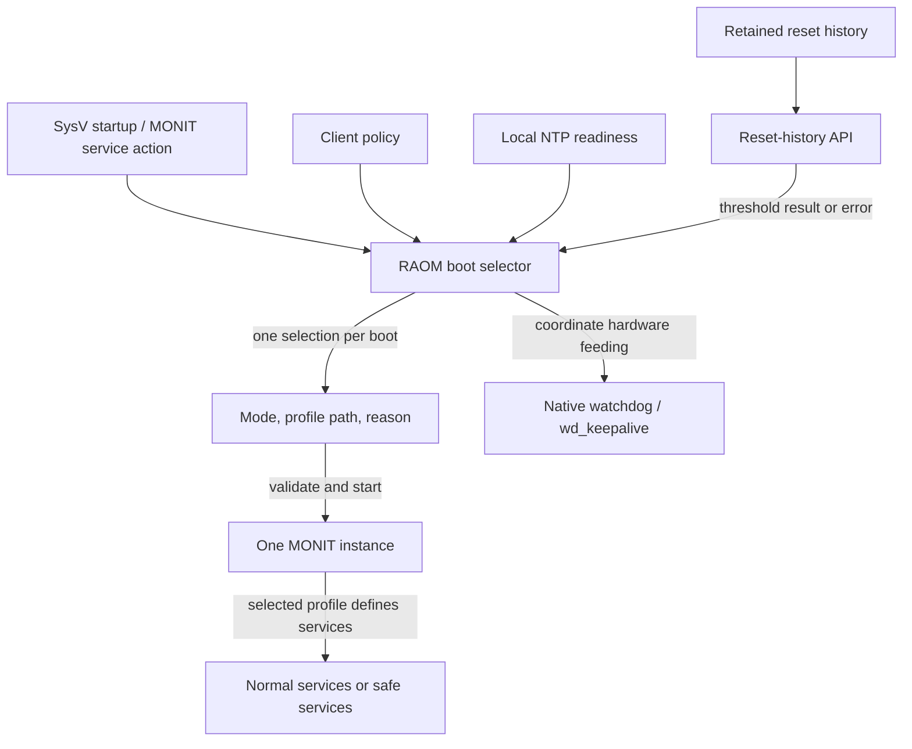
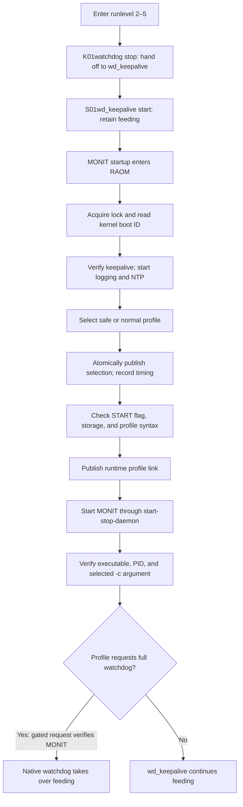
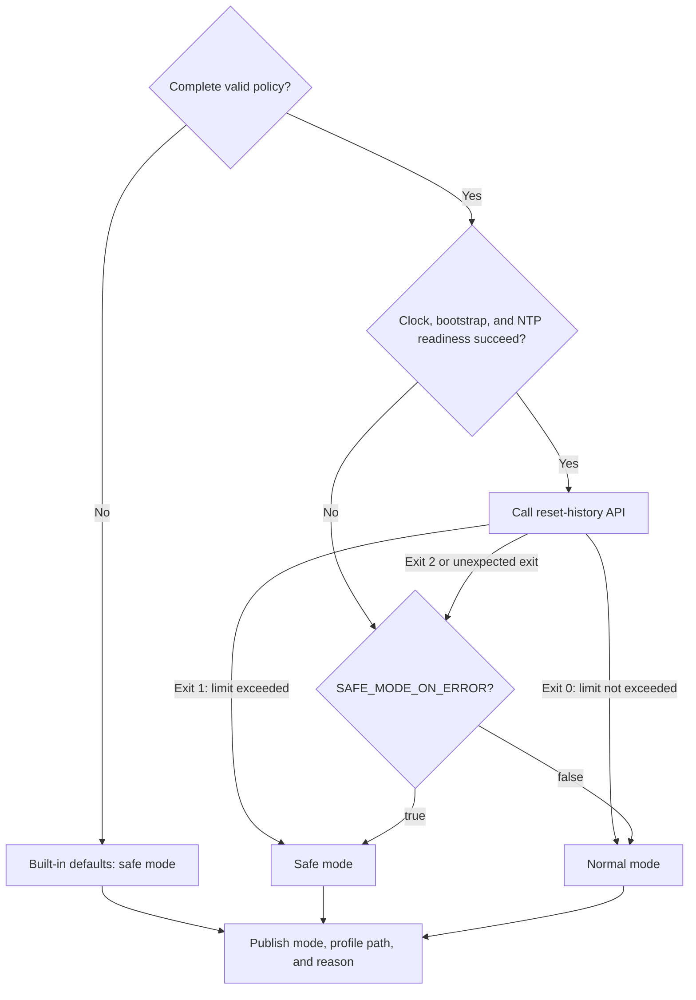

# 1. Overview

RAOM selects safe or normal operation before MONIT starts. Recent reset history determines whether normal services can start.
On excessive resets, RAOM selects safe mode. On unavailable evidence, configurable error policy selects safe or normal mode.

RAOM starts one MONIT instance with selected profile. MONIT supervises services defined by that profile.
RAOM coordinates native watchdog and `wd_keepalive` so hardware feeding continues during boot decisions and planned MONIT stops.

| # | Mode | Purpose | Default profile |
| --- | --- | --- | --- |
| 1 | Normal | Run client production services. Platform supplies profile contents. | `/etc/monit/monitrc` |
| 2 | Safe | Run client recovery services. Shipped sample supervises only `wd_keepalive`. | `/etc/monit/raom/safe.monitrc` |

Client owns production profiles. Shipped safe sample provides hardware feeding, not a complete recovery environment.
Mode and profile path stay fixed for current kernel boot. Next boot evaluates retained reset history again.

Debian package `scr-raom` 1.1.0 delivers RAOM and [reset-history API](../resets-monitor/README.md).

<div style="page-break-after: always;"></div>

# 2. High Level & Low Level Design

## 2.1 High-level architecture

RAOM combines client policy, NTP readiness, and reset API result into one boot selection.
Reset API owns reset counts, history refresh, and evidence quality. RAOM owns mode selection and MONIT startup.



## 2.2 Boot process

Runlevels 2–5 retain scheduler identity `monit`. Legacy `S03monit` links target `scr-raom`.
Dependency-based startup uses adapted `/etc/init.d/monit`. Both routes reach RAOM before MONIT starts.

Diagram shows first service start in a new boot. Startup errors can stop launch at each validation or handoff boundary.



RAOM holds one lock through bootstrap, selection, publication, and service action.
Later service starts reuse current-boot selection. They validate selected profile without repeating reset evaluation.
Configuration edits affect selection on next boot. Profile contents remain client-managed and can change at selected path.

Native logging and NTP startup each use separate 10-second command budgets.
NTP readiness deadline starts at decision entry, after bootstrap attempt.
`NTP_SYNC_TIMEOUT_SECONDS` covers readiness wait, not complete boot duration.
Linux `/proc/uptime` supplies monotonic time. Wall-clock changes cannot extend this wait.

## 2.3 Safe and normal mode selection

NTP readiness requires local `ntpq -c 'rv 0'` output with both `leap_none,` and `sync_ntp,`.
Each probe uses at most two seconds, capped by remaining readiness budget.
After readiness, RAOM calls reset API with a separate 15-second command budget:

```bash
/usr/bin/scr-resets-monitor check --max-resets "$MAX_RESETS" --window "$RESET_WINDOW_SECONDS"
```

Diagram applies to a new decision. Existing valid selection bypasses this decision flow.



| # | Evidence | Stored reason | Selection |
| --- | --- | --- | --- |
| 1 | API exit `0` | `below_threshold` | Normal. Limit is not exceeded. |
| 2 | API exit `1` | `threshold_exceeded` | Safe, regardless of error policy. |
| 3 | API exit `2` | `reset_evidence_unavailable` | Error policy selects safe or normal. |
| 4 | Unexpected API exit, including command timeout | `reset_api_failed` | Error policy selects safe or normal. |
| 5 | NTP readiness deadline expires | `ntp_timeout` | Error policy selects safe or normal. |
| 6 | Native logging or NTP bootstrap fails | `ntp_start_failed` | Error policy selects safe or normal. |
| 7 | Invalid client configuration | `configuration_invalid` | Complete built-in defaults select safe. |
| 8 | Monotonic clock unavailable or invalid | `clock_unavailable` | If state publication remains possible, error policy applies. |

Threshold uses strictly more than `MAX_RESETS`. With default limit `5`, five resets do not exceed threshold. Six resets do.
API still requires sufficient reliable evidence for its result.
Error-permitted normal mode does not mean reliable evidence proved reset count acceptable. Stored reason preserves this distinction.

If keepalive, runtime storage, boot identity, or atomic publication is unavailable, selection can fail entirely.
Successful selection does not prove MONIT launch. Missing binary/profile, invalid syntax, or unusable runtime storage can still prevent launch.
Failed safe launch never substitutes normal profile.

## 2.4 Low-level components and state

| # | Source | Responsibility |
| --- | --- | --- |
| 1 | [`../../bin/src-raom`](../../bin/src-raom) | Load shared SCR libraries, reset numeric parser, and RAOM modules. |
| 2 | [`tool.sh`](tool.sh) | Parse commands, require root, hold invocation lock, and dispatch actions. |
| 3 | [`src/decision.sh`](src/decision.sh) | Parse policy, wait for NTP, consume reset result, and publish selection. |
| 4 | [`src/monit.sh`](src/monit.sh) | Bootstrap services, validate MONIT, coordinate feeders, and record decision timing. |
| 5 | [`src/scr-raom.init`](src/scr-raom.init) | Route SysV lifecycle actions through RAOM. |
| 6 | [`etc/raom.conf`](etc/raom.conf) | Define trusted internal paths and fallback profile paths. |
| 7 | [`etc/default-policy.conf`](etc/default-policy.conf) | Supply default client policy. |
| 8 | [`etc/runlevels.conf`](etc/runlevels.conf) | Define startup links while retaining scheduler identity `monit`. |

Shared SCR libraries supply logging and root checks. Client policy contains data only. RAOM never sources it as shell code.

| # | Runtime path | Contract |
| --- | --- | --- |
| 1 | `/run/scr-raom/` | Root-owned private directory, mode `0700`. |
| 2 | `/run/scr-raom/lock` | Serializes RAOM operations. Lock acquisition waits at most two seconds. |
| 3 | `/run/scr-raom/selection` | Atomic five-field record: `schema`, `boot_id`, `mode`, `profile`, `reason`. |
| 4 | `/run/scr-raom/monitrc` | Link to selected profile, published only after syntax validation. |
| 5 | `/proc/sys/kernel/random/boot_id` | Identifies current kernel boot. |
| 6 | `/run/monit.pid` | Native MONIT PID file, used with executable and command-line checks. |

Lock and selection files require owner root, mode `0600`, and one hard link. RAOM rejects redirected or unsafe state paths.
Atomic rename publishes complete selection. Corrupt selection fails instead of silently choosing normal.
Valid current-boot selection fixes mode and profile path. RAOM provides no automatic same-boot return to normal.

## 2.5 Native startup adapters

[`etc/compat/`](etc/compat/) contains installed adapters. Debian diversions retain native files under `/usr/share/scr-raom/diverted/`.

| # | Source | Installed path | Purpose |
| --- | --- | --- | --- |
| 1 | `monit.init` | `/etc/init.d/monit` | Route lifecycle actions through RAOM. Native status stays lock-free for watchdog checks. |
| 2 | `monitrc` | `/etc/monitrc` | Include validated `/run/scr-raom/monitrc` for default MONIT CLI calls. |
| 3 | `monitstate.sh` | `/sbin/monitstate.sh` | Start MONIT through gated init entry. |
| 4 | `rc.local` | `/etc/rc.local` | Run gated startup and platform setup while preserving MONIT state. |
| 5 | `watchdog.init` | `/etc/init.d/watchdog` | Gate activation on selected running MONIT. Stop transfers feeding to native keepalive. |

Missing runtime profile link makes default MONIT CLI configuration fail closed.
`/etc/default/monit` supplies native `START` flag. Startup requires `START=yes`.
Conflicting `MONIT_OPTS` profile/PID arguments fail startup. Running instance must expose exactly one selected explicit `-c` path.

## 2.6 Watchdog protection

Normal profile on SCR-7CCC91 requests full watchdog through `99-watchdog`.
That daemon checks MONIT PID file and runs `/sbin/monit-status.sh`.
Stock safe profile supervises only `wd_keepalive`, which feeds hardware timer without full watchdog checks on MONIT.

Client safe profile can request full watchdog through `/etc/init.d/watchdog start`.
Same selection and process checks apply in both modes. Native watchdog takes over hardware feeding from keepalive.
Client profile must choose which feeder it supervises.

Before planned MONIT stop or restart, RAOM requires keepalive executable, stops full watchdog, and verifies its absence.
RAOM then starts or verifies native keepalive through bounded `start-stop-daemon --status --exec` checks.
Only successful handoff permits MONIT stop. Parent retains lock through restart, so concurrent watchdog requests cannot bypass this transition.

After restart, selected profile can request full watchdog again. If MONIT stays stopped, keepalive continues feeding.
If handoff fails, RAOM preserves MONIT PID and reports failure.
RAOM attempts to restore previous full watchdog only against verified selected MONIT. If neither feeder can be verified, hardware feeding is unconfirmed.

## 2.7 Verification boundaries

Decision and boot checks cover selection, bounded waits, startup order, and launch failures. Package checks cover dpkg lifecycle and configuration preservation.
[`test/check-integration.sh`](test/check-integration.sh) installs application and dependency fixtures through real `.deb` archives in approved disposable Debian root.
Installed selector consumes installed reset CLI. SEMA/NTP fixtures supply controlled observations without hardware access.
Private mount/PID namespace supplies `/proc`. Real MONIT syntax checks do not start daemons.
Physical boot and watchdog behavior require hardware acceptance with exact package.

<div style="page-break-after: always;"></div>

# 3. User Manual

## 3.1 Build and install

Package installs operational files under `/usr/local/scr/`.
`/usr/bin/scr-raom` links to `/usr/local/scr/bin/src-raom`.
`/usr/bin/scr-resets-monitor` links to `/usr/local/scr/bin/src-resets-monitor`.
Platform supplies normal MONIT profile, MONIT/watchdog binaries, and native watchdog checks.

1. BUILD package from repository root:

   ```bash
   ./bin/lets deb build etc/deb/raom/deb.conf
   ```

2. On authorized target, INSTALL built archive as root:

   ```bash
   dpkg --install src/pkg/scr-raom_1.1.0_all.deb
   ```

   Path assumes archive exists under `src/pkg/` in current directory. For transferred archive, use its target path.

Package callbacks never start services, feed watchdog, or reboot.
Foreign ownership, another package's active diversions, and unsupported native integration files stop installation.
Standard conffiles preserve client configuration.

## 3.2 Configure policy and profiles

Client policy lives in `/etc/default/scr-raom`. All six keys required. Values use unquoted `KEY=value` lines.
Blank lines and whole-line comments allowed. Default policy:

```text
MAX_RESETS=5
RESET_WINDOW_SECONDS=900
NTP_SYNC_TIMEOUT_SECONDS=60
SAFE_MODE_ON_ERROR=true
SAFE_PROFILE=/etc/monit/raom/safe.monitrc
NORMAL_PROFILE=/etc/monit/monitrc
```

| # | Key | Contract |
| --- | --- | --- |
| 1 | `MAX_RESETS` | Reset limit, integer `0..2147483647`. Strictly more resets selects safe. |
| 2 | `RESET_WINDOW_SECONDS` | Reset window in seconds, integer `1..2147483647`. |
| 3 | `NTP_SYNC_TIMEOUT_SECONDS` | NTP readiness budget in seconds, integer `1..2147483647`. |
| 4 | `SAFE_MODE_ON_ERROR` | Literal `true` or `false`. False permits normal selection on decision errors. |
| 5 | `SAFE_PROFILE` | Absolute safe-profile path. Built-in path `/etc/monit/raom/safe.monitrc`. |
| 6 | `NORMAL_PROFILE` | Absolute normal-profile path. Built-in path `/etc/monit/monitrc`. |

Missing, unreadable, malformed, partial, duplicate-key, or unknown-key configuration discards all supplied values.
Complete built-in defaults apply, including `SAFE_MODE_ON_ERROR=true`.
Quoted values, shell expansions, and inline comments receive no shell interpretation.
Profile paths cannot contain control characters or equal `/`. Numeric limits prevent overflow.

1. SET production threshold, reset window, and NTP timeout in `/etc/default/scr-raom`.
2. DEFINE production services in normal profile.
3. DEFINE required recovery services and feeder in safe profile.
4. SET `START=yes` in `/etc/default/monit` to enable MONIT startup.

Policy changes affect next boot selection. Restart or reload retains current mode and profile path.
No command forces a new mode during current boot.

## 3.3 Inspect current boot

Help works without root or runtime access. Other RAOM commands require root.
These commands do not start services:

```bash
/usr/bin/scr-raom --help
/usr/bin/scr-raom status
/usr/bin/scr-raom profile
/usr/bin/scr-resets-monitor status --json
/etc/init.d/monit status
```

`status` prints `schema`, `boot_id`, `mode`, `profile`, and `reason`. `profile` prints selected path.
Both require existing current-boot selection. Native MONIT `status` reports process state without RAOM lock.
Selection status and process status answer different questions: which profile was selected, and whether MONIT runs.

## 3.4 Manage services

Following commands change service state. They require authorization for target service operations.

| # | Command | Behavior |
| --- | --- | --- |
| 1 | `/etc/init.d/monit start` | Create or reuse selection, validate profile, and start selected MONIT. |
| 2 | `/etc/init.d/monit stop` | Transfer feeding to keepalive before stopping MONIT. |
| 3 | `/etc/init.d/monit restart` | Retain selection and coordinate feeding across MONIT restart. |
| 4 | `/etc/init.d/monit force-reload` | Use same stop/start path as restart. |
| 5 | `/etc/init.d/monit reload` | Validate selected profile and send HUP. Requires existing selection. |
| 6 | `/etc/init.d/watchdog start` | Verify selected MONIT before native watchdog takes over feeding. |
| 7 | `/etc/init.d/watchdog stop` | Transfer feeding to native keepalive. |

`/usr/bin/scr-raom monit ACTION` exposes same MONIT actions, including `syntax`.
`/etc/init.d/monit syntax` validates existing selected profile and publishes runtime profile link without launching MONIT.
Watchdog interface also accepts `restart` and `force-reload` through same guarded handoff.

Standalone `/usr/bin/scr-raom select` creates selection without MONIT launch. Caller must first complete bounded native NTP bootstrap.
`select --ntp-start-failed` records bootstrap failure for error policy. Service entry performs bootstrap automatically.
If full watchdog is active, standalone `select` returns `watchdog_not_idle`. Service entry can perform required handoff.

RAOM exit `0` means requested operation succeeded. For `select`, safe mode is also success.
Exit `2` means unavailable operation or invalid arguments. These codes differ from reset API threshold codes in section 2.3.

## 3.5 Diagnose selection and startup

1. READ `/usr/bin/scr-raom status` output for selected mode and reason.
2. READ `/etc/init.d/monit status` output for native process state.
3. READ stderr and native syslog entries tagged `scr-raom` for decision and launch diagnostics.

| # | Symptom or reason | Meaning / action |
| --- | --- | --- |
| 1 | `threshold_exceeded` | Reset API proved limit exceeded. Inspect reset history and reset cause. |
| 2 | `configuration_invalid` | Entire policy rejected. Verify all six keys and literal value format. |
| 3 | `ntp_start_failed` / `ntp_timeout` | Bootstrap or readiness failed. Inspect native logging, NTP, and local `ntpq` output. |
| 4 | `reset_evidence_unavailable` / `reset_api_failed` | Reset API supplied no usable decision. Inspect reset CLI status and diagnostics. |
| 5 | `selection_unavailable` | Selection absent, invalid, or from another boot. Inspection commands do not create one. |
| 6 | `monit_disabled` / `conflicting_monit_options` | Native MONIT defaults block startup. Verify `START` and `MONIT_OPTS`. |
| 7 | `selected_profile_unavailable` / `selected_profile_invalid` | Selected profile missing, unreadable, or invalid. Repair selected profile. |
| 8 | `running_profile_mismatch` / `running_profile_unverified` | Existing MONIT does not prove selected profile identity. Inspect PID and command line. |
| 9 | `keepalive_unavailable` / `watchdog_stop_unverified` | Feeder handoff failed. Hardware feeding needs verification through native process evidence. |

Each new service decision writes one timing record to stderr and native syslog.
Fields: `boot_id`, `mode`, `reason`, and `decision_ms`.
Measurement starts before keepalive handoff and logging/NTP bootstrap. It ends immediately after selection publication.
Measurement includes readiness wait and reset API call, with 10 ms clock resolution.
Earlier SysV actions, lock wait, MONIT startup, and cached service calls remain outside measurement.

If timing is unavailable, record contains `decision_ms=unavailable`. Logging error leaves selection intact.
Comparable timings require fresh decisions with same NTP conditions and policy.

## 3.6 Roll back or remove package

For same-package rollback, retained `scr-raom` archive restores earlier package version. Local conffiles can remain in place.

1. Before package-owner change, SAVE offline copy of live reset data and client configuration through rollback.
2. For version rollback, INSTALL retained archive with `dpkg --install`.
3. When dpkg prompts during rollback, KEEP local conffiles.

`dpkg --remove scr-raom` restores native startup paths and retains client policy.
`dpkg --purge scr-raom` deletes package conffiles.
