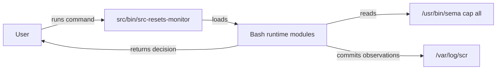

# scr-resets-monitor

`scr-resets-monitor` reads reset counters from an ADLINK SEMA BMC interface, stores observations, and provides a reset-threshold decision API. It uses Bash and the installed `/usr/bin/sema` command. It does not control boot, change BMC settings, or activate recovery policy.

## Design

The package provides a one-shot observation tool, not a long-running daemon. The SysV startup hook starts one bounded `record` operation in the background.

1. `record` runs `/usr/bin/sema cap all`, parses required BMC fields, and compares counters with the last committed observation.
2. The first valid observation establishes a baseline with zero deltas. Later observations store boot-count and power-cycle deltas separately.
3. A counter delta greater than one stays aggregated. The tool records the observation time and does not invent individual reset times or causes.
4. `status --json` reads committed history without querying the BMC.
5. `check` refreshes the observation and uses boot-count deltas to decide whether the reset limit was exceeded within the requested time window.
6. Clock uncertainty bounds each observation interval. The tool returns unavailable when evidence cannot support a safe decision.
7. History and the latest state are committed under a lock. Failed reads or writes do not advance the saved baseline.

The runtime entry point loads shared SCR libraries, the runtime modules, and the tool command layer:



## Repository layout

| # | Path | Purpose |
|---|---|---|
| 1 | `src/bin/src-resets-monitor` | Loads SCR libraries and monitor modules, then dispatches the command. |
| 2 | `src/tools/resets-monitor/tool.sh` | Parses arguments, prints usage, and runs `record`, `status`, or `check`. |
| 3 | `src/tools/resets-monitor/src/runtime/bmc.sh` | Runs the bounded SEMA query and parses BMC fields. |
| 4 | `src/tools/resets-monitor/src/runtime/record.sh` | Compares counters and builds observation records. |
| 5 | `src/tools/resets-monitor/src/runtime/time.sh` | Captures clock evidence and calculates conservative reset-window bounds. |
| 6 | `src/tools/resets-monitor/src/runtime/history.sh` | Validates and commits the JSONL history and state cache. |
| 7 | `src/tools/resets-monitor/src/runtime/status.sh` | Returns the latest committed observation as JSON. |
| 8 | `src/tools/resets-monitor/src/runtime/values.sh` and `diagnostics.sh` | Parse bounded values and write diagnostics. |
| 9 | `src/tools/resets-monitor/src/scr-resets-monitor.init` | Provides the SysV one-shot startup hook. |
| 10 | `src/tools/resets-monitor/src/rotation-hooks` | Coordinates history access with log rotation. |
| 11 | `src/tools/resets-monitor/etc/` | Holds Debian build, logrotate, and inactive Monit example configuration. |
| 12 | `src/tools/resets-monitor/pkg/` | Holds Debian control metadata and lifecycle scripts. |
| 13 | `src/tools/resets-monitor/src/package-common.sh` | Supplies shared package install, upgrade, and restoration logic. |
| 14 | `src/tools/resets-monitor/test/` | Holds runtime, package, build, and target-runner checks and fixtures. |
| 15 | `src/etc/scr.conf` and `src/lib/` | Provide shared SCR paths, logging, and command helpers. |

## Debian package

`src/tools/resets-monitor/etc/deb.conf` defines the files copied into package staging. LETS builds the package from the repository root:

```bash
./bin/lets deb build src/tools/resets-monitor/etc/deb.conf
```

The build creates staging files under `build/resets-monitor/` and the Debian archive under `build/`. The current package is `build/scr-resets-monitor_1.0.7_all.deb`. The `build/` directory is ignored by Git. The package architecture is `all` because it contains shell scripts; target hardware still needs a compatible SEMA interface.

The archive carries the source payload under `/usr/lib/scr-resets-monitor/payload/`. Debian maintainer scripts install it under `/usr/local/scr/` after they save original managed files.

Copy and install the package on the target:

```bash
scp build/scr-resets-monitor_1.0.7_all.deb root@TARGET:/tmp/
ssh root@TARGET
dpkg -i /tmp/scr-resets-monitor_1.0.7_all.deb
```

Run `dpkg -i` again to upgrade the installed package. Debian maintainer scripts save original managed files on first install, preserve them across upgrades, and restore them when the package is removed. Export any logs that must outlive package removal.

## Target prerequisites

| # | Requirement | Purpose |
|---|---|---|
| 1 | Debian or compatible system with `dpkg` and SysV startup support | Installs the package and runs its early-boot hook. |
| 2 | Root access | Required for the monitor commands and package lifecycle. |
| 3 | Bash 4.3 or later, `coreutils`, `util-linux`, `gzip`, and `tar` | Declared Debian package dependencies. |
| 4 | ADLINK-compatible SEMA firmware, library, and `/usr/bin/sema` | Supplies read-only BMC readings. The package does not install SEMA. |
| 5 | `ntpq` with synchronized NTP data | Supplies clock-health evidence for valid timestamps and reset-window decisions. Without valid clock evidence, `check` returns 2. |
| 6 | `logrotate` | Runs the installed rotation policy and its history-coordination hooks. The package does not declare it as a dependency. |
| 7 | Writable `/var/log` and `/run/lock` filesystems | Stores history, state, diagnostics, and the invocation lock. |

## Run on the target

Run commands as root. `record` reads the BMC and commits an observation:

```bash
/usr/bin/scr-resets-monitor record
```

Read the latest committed observation without a new BMC query:

```bash
/usr/bin/scr-resets-monitor status --json
```

Evaluate a threshold with an explicit limit and window in seconds:

```bash
/usr/bin/scr-resets-monitor check --max-resets 3 --window 3600
```

Both `--max-resets` and `--window` are required. Exit `0` means the limit is not exceeded. Exit `1` means reliable evidence proves the limit was exceeded. Exit `2` means the result is unavailable or indeterminate. `check` never starts a recovery action.

The monitor stores data in `/var/log/scr/`:

| # | File | Contents |
|---|---|---|
| 1 | `resets.jsonl` | Append-only observation and counter-delta history. |
| 2 | `resets-state.json` | Latest committed observation and baseline. |
| 3 | `resets-monitor.log` | Diagnostics and recovery messages. |

The monitor restricts the directory to root and mode `0700`. It restricts data files to root and mode `0600`.

## OS integration

1. The package installs its source tree under `/usr/local/scr/`. `/usr/bin/scr-resets-monitor` links to `/usr/local/scr/bin/src-resets-monitor`.
2. `/etc/init.d/scr-resets-monitor` provides `start`, `stop`, and restart actions. `/etc/rcS.d/S17scr-resets-monitor` links to the startup script and starts one asynchronous observation.
3. `/etc/logrotate.d/scr-resets-monitor` lets the host rotate the JSONL history and diagnostic log. Rotation hooks lock history access and preserve the committed sequence. The host keeps control of rotation timing and retention.
4. The package installs an inactive Monit example under `/usr/local/scr/tools/resets-monitor/etc/monit-example.conf`. Its threshold values are placeholders. The package does not enable it.
5. Package scripts track managed paths, retain original backups under `/var/lib/scr-resets-monitor/`, and restore original files and metadata on removal.
