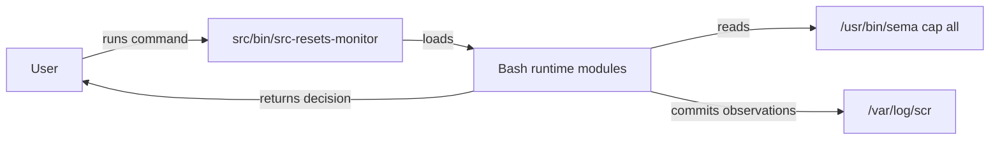

# scr-resets-monitor

`scr-resets-monitor` reads reset counters through ADLINK SEMA, stores observations, and provides reset-threshold API. CLI never changes BMC settings or starts recovery.
The `scr-raom` Debian package also delivers [RAOM boot selection](../raom/README.md), which consumes this API and starts MONIT with safe or normal profile.

## Design

Reset CLI is one-shot tool. RAOM calls `check` during boot after native NTP bootstrap/readiness.

1. `record` runs `/usr/bin/sema cap all`, parses required BMC fields, and compares counters with the last committed observation.
2. The first valid observation establishes a baseline with zero deltas. Later observations store boot-count and power-cycle deltas separately.
3. A counter delta greater than one stays aggregated. The tool records the observation time and does not invent individual reset times or causes.
4. `status --json` reads committed history without querying the BMC.
5. `check` refreshes the observation and uses boot-count deltas to decide whether the reset limit was exceeded within the requested time window.
6. Clock uncertainty bounds each observation interval. The tool returns unavailable when evidence cannot support a safe decision.
7. History and the latest state are committed under a lock. Failed reads or writes do not advance the saved baseline.

The runtime entry point loads shared SCR libraries, the runtime modules, and the tool command layer:



## Repository layout

| # | Path | Purpose |
|---|---|---|
| 1 | `src/bin/src-resets-monitor` | Loads SCR libraries and monitor modules, then dispatches the command. |
| 2 | `src/tools/resets-monitor/tool.sh` | Parses arguments, prints usage, and runs `record`, `status`, or `check`. |
| 3 | `src/tools/resets-monitor/src/runtime/bmc.sh` | Runs the bounded SEMA query and parses BMC fields. |
| 4 | `src/tools/resets-monitor/src/runtime/record.sh` | Compares counters and builds observation records. |
| 5 | `src/tools/resets-monitor/src/runtime/time.sh` | Captures clock evidence and calculates conservative reset-window bounds. |
| 6 | `src/tools/resets-monitor/src/runtime/history.sh` | Validates and commits the JSONL history and state cache. |
| 7 | `src/tools/resets-monitor/src/runtime/status.sh` | Returns the latest committed observation as JSON. |
| 8 | `src/tools/resets-monitor/src/runtime/values.sh` and `diagnostics.sh` | Parse bounded values and write diagnostics. |
| 9 | `src/tools/resets-monitor/src/scr-resets-monitor.init` | Provides explicit one-shot observation service. RAOM owns automatic boot evaluation. |
| 10 | `src/tools/resets-monitor/src/rotation-hooks` | Coordinates history access with log rotation. |
| 11 | `src/tools/resets-monitor/etc/` | Holds logrotate configuration and an inactive MONIT example. |
| 12 | `etc/deb/raom/` | Defines the combined package, installed links, and dpkg callbacks. |
| 13 | `etc/deb/raom/package-common.sh` | Supplies project-specific Debian installation and diversion callbacks. |
| 14 | `src/tools/resets-monitor/test/` | Holds runtime, package, build, and target-runner checks and fixtures. |
| 15 | `src/etc/scr.conf` and `src/lib/` | Provide shared SCR paths, logging, and command helpers. |

## Debian package

`etc/deb/raom/deb.conf` defines the files copied into package staging. LETS builds the package from the repository root:

```bash
./bin/lets deb build etc/deb/raom/deb.conf
```

LETS stages files in `build/scr-raom/` and writes `src/pkg/scr-raom_1.1.0_all.deb`. Git ignores both generated directories.
Generated archives under `src/pkg/` are excluded from the package payload.
Architecture is `all` because application contains shell scripts. Target still needs compatible SEMA and native runtime prerequisites.

dpkg installs operational source directly under `/usr/local/scr/`.
Debian diversions retain replaced native integration paths. Standard conffiles preserve client configuration. Maintainer scripts never start services or reboot.

Target installation requires separate explicit authority. On authorized target:

```bash
dpkg --install /tmp/scr-raom_1.1.0_all.deb
```

## Target prerequisites

| # | Requirement | Purpose |
|---|---|---|
| 1 | Debian with `dpkg` and SysV startup support | Installs package and native RAOM boot integration. Merged-/usr roots are unsupported by current package layout. |
| 2 | Root access | Required for the monitor commands and package lifecycle. |
| 3 | Bash 4.3 or later, `coreutils`, `util-linux`, and `dpkg` 1.17 or later | Declared Debian package dependencies. |
| 4 | ADLINK-compatible SEMA firmware, library, and `/usr/bin/sema` | Supplies read-only BMC readings. The package does not install SEMA. |
| 5 | `ntpq` with synchronized NTP data | Supplies clock-health evidence for valid timestamps and reset-window decisions. Without valid clock evidence, `check` returns 2. |
| 6 | `logrotate` | Runs the installed rotation policy and its history-coordination hooks. The package does not declare it as a dependency. |
| 7 | Writable `/var/log` and `/run/lock` filesystems | Stores history, state, diagnostics, and the invocation lock. |
| 8 | MONIT, native NTP/logging, `watchdog`, and `wd_keepalive` | RAOM verifies native feeder handoff before planned MONIT stops and restarts. |

## Run on the target

Run commands as root. `record` reads the BMC and commits an observation:

```bash
/usr/bin/scr-resets-monitor record
```

Read the latest committed observation without a new BMC query:

```bash
/usr/bin/scr-resets-monitor status --json
```

Evaluate a threshold with an explicit limit and window in seconds:

```bash
/usr/bin/scr-resets-monitor check --max-resets 3 --window 3600
```

Both `--max-resets` and `--window` are required. Exit `0` means the limit is not exceeded. Exit `1` means reliable evidence proves the limit was exceeded. Exit `2` means the result is unavailable or indeterminate. `check` never starts a recovery action.

The monitor stores data in `/var/log/scr/`:

| # | File | Contents |
|---|---|---|
| 1 | `resets.jsonl` | Append-only observation and counter-delta history. |
| 2 | `resets-state.json` | Latest committed observation and baseline. |
| 3 | `resets-monitor.log` | Diagnostics and recovery messages. |

The monitor restricts the directory to root and mode `0700`. It restricts data files to root and mode `0600`.

## OS integration

1. The package installs its source tree under `/usr/local/scr/`. `/usr/bin/scr-resets-monitor` links to `/usr/local/scr/bin/src-resets-monitor`.
2. `/etc/init.d/scr-resets-monitor` provides explicit one-shot interface. RAOM owns automatic boot decision.
3. `/etc/logrotate.d/scr-resets-monitor` lets the host rotate the JSONL history and diagnostic log. Rotation hooks lock history access and preserve the committed sequence. The host keeps control of rotation timing and retention.
4. The package installs an inactive Monit example under `/usr/local/scr/tools/resets-monitor/etc/monit-example.conf`. Its threshold values are placeholders. The package does not enable it.
5. dpkg owns installed paths and tracks diversions for native startup adapters.
6. `/etc/default/scr-raom` configures `MAX_RESETS=5`, `RESET_WINDOW_SECONDS=900`, `NTP_SYNC_TIMEOUT_SECONDS=60`, `SAFE_MODE_ON_ERROR=true`, and profile paths. Invalid configuration uses complete defaults.
7. RAOM fixes mode/profile path per boot. API exit 1 always selects safe. API errors remain errors, even when configured policy permits normal.

Full configuration, launch failures, client sample limits, and installed interfaces: [RAOM operator guide](../raom/README.md).
